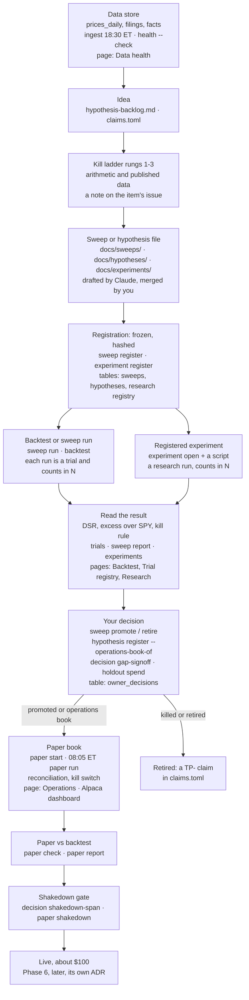

# Runbook: the owner's guide to using TradePartner

**For:** Jose, as the user, not as a developer  ·  **Date:** 2026-10-20  ·  **Issue:** [#1932](https://github.com/josejuarez96/tradepartner/issues/1932)  ·  **Checked against:** merged code and PRs on `origin/main` at `2bcc6989`, 2026-10-20

This is the one page to read to run TradePartner yourself. It shows how the parts connect, which command to type at each step, and where to look. It does not replace the detailed runbooks. It points to them.

All commands run from the main checkout, as `uv run tradepartner <command>`. Two reports from 10-19 back this page: [a day in the life](../research/2026-10-19-owner-day-in-the-life.md) (what you see) and [MVP readiness](../research/2026-10-19-mvp-usability-readiness.md) (what works). Store facts quoted from them, such as trial counts and book windows, were read on 10-19. They will change.

## Terms, once

| Term | Plain meaning |
|---|---|
| **Store** | The one database file on your Mac (`data/tradepartner.duckdb`). Prices, filings, trials and the paper journal all live in it. |
| **Point-in-time** | Every fact carries the moment it became known (`known_at`), so a test only reads what was knowable that day. |
| **Survivorship gap** | Companies that died and are missing from our history. A backtest records how many it missed. You sign off that gap before paper. |
| **Family** | A group of related ideas, such as `momentum`. A family shares one holdout and one trial count. |
| **Hypothesis file** | A Markdown file that freezes every setting of one strategy before any run. Changing a setting later means a new file. |
| **Sweep** | One file that tries several settings at once (a grid). Each setting is a **variant**, and each variant run is a trial. |
| **Pre-registration** | Recording the file in the store before running it. Its settings get a hash and can no longer move. |
| **Trial** | One backtest run, logged in the trial registry whatever happens: good, bad, failed or refused. |
| **N (trial count)** | How many trials the family has run. The more you try, the more likely the best one is luck. N never goes down. |
| **In-sample** | The history you are allowed to test on freely (for `momentum`, up to 2023-12-29). |
| **Holdout** | A sealed stretch of history (for `momentum`, 2024-01-01 to 2026-09-30) that no test reads until you spend it, once, on purpose, with a reason. `momentum` has already spent its holdout (trial 4). |
| **Sharpe** | Return per unit of risk, per year. |
| **SR\*** | The best Sharpe you would expect from N tries of pure luck. It rises as N rises. |
| **DSR (deflated Sharpe)** | The chance the strategy's Sharpe beats SR\*. Read it as "how likely this is real, after counting every try". Above 0.95 is strong. About 0.5 is a coin flip. |
| **Backtest vs experiment** | A **backtest** runs a strategy through the engine and writes a trial. An **experiment** is any other registered study (a long/short spread, a labelling test). It writes a research run, not a trial, and today it needs a script. |
| **Kill ladder** | Five cheap-to-expensive tests an idea must survive, each with a kill rule written first ([ADR 0023](../decisions/0023-break-first-fast-books-paper-exam.md)): 1 cost break-even, 2 the published long leg, 3 capacity at $100, 4 a harsh backtest, 5 placebo. |
| **Book** | One paper strategy with its own Alpaca paper account. Today: `main` (H1, monthly) and `daily` (a machine test). |
| **Window** | One continuous run of a book, from `paper start` to stop. Its record is judged on its own. |
| **Operations book vs exam** | An **operations book** tests the machine, never the strategy. An **exam** is a pre-registered book whose family's holdout is unspent and which reaches a minimum number of rebalances and fills ([ADR 0023](../decisions/0023-break-first-fast-books-paper-exam.md)). It is the strategy's real test. Every `momentum` book is a tracking window, not an exam, because its holdout is spent. |
| **Kill switch** | A per-book stop. While engaged, the daily run still checks the broker but places no order. |
| **Shakedown** | The machine-readiness gate before live money: `paper shakedown` must pass all seven lines ([ADR 0017](../decisions/0017-fast-paper-and-machine-readiness-gate.md) part E). |

## 1. The big picture

Read it top to bottom. Data feeds ideas. An idea becomes a frozen file. Running the file writes trials that raise the bar for every later idea. You read the result and decide. Only a survivor goes to a paper book. The machine must then pass the shakedown before any live money.

## 2. The research loop, step by step

### Where ideas come from
- [hypothesis-backlog.md](../research/hypothesis-backlog.md): every candidate, its order, its status and its kill criteria. The **ladder ledger** at its end records each rung's verdict.
- [claims.toml](../research/claims.toml): one line per research finding with its evidence grade (SUPPORTED, MIXED, NOT SUPPORTED, INSUFFICIENT). Our own results go in as `TP-` claims.
- Your own idea: ask Claude, "has this been tried, and what does the evidence say?" It reads these two files.

### Who writes the file
- **Claude drafts it on your request, and you approve the PR.** You may also write it yourself from the template.
- A **new idea in an existing family** is a **sweep file**, even with one setting: copy [templates/sweep.md](../templates/sweep.md) to `docs/sweeps/<slug>.md`. Your store has the strategy lab set up, so `hypothesis register` refuses any new standalone file with "write it as a one-value sweep".
- A **hypothesis file** ([templates/hypothesis.md](../templates/hypothesis.md), `docs/hypotheses/<slug>.md`) is used only for a promoted sweep winner or an operations book.
- An **experiment file** ([templates/experiment.md](../templates/experiment.md), `docs/experiments/<slug>.md`) is for a study that is not a backtest.
- A **new kind of signal** (not new settings for an existing one) is code. It needs a plan task and an agent build first.
- **Merging a file does not register it.** You register it after the merge.

### The commands, in order

| Step | Command (real flags) | What it does |
|---|---|---|
| 1. Check the data | `health --check` | Exits non-zero if an integrity rule fails. Clear its review lists before registering. |
| 2. Register a sweep | `sweep register docs/sweeps/<slug>.md` | Freezes one hypothesis per variant. Writes no trial yet. |
| 3. Run it | `sweep run <slug>` (optional `--time-budget-minutes <m>`, `--note "<text>"`) | Runs every variant as a trial. Every trial counts in N. Run it outside 16:00-21:00 ET and away from the 08:05 run. |
| 4. Read it | `sweep report <slug>`; `sweep status`; `trials`; `trials --hypothesis <slug>`; `lab status` | Every variant, the distribution and the verdicts; trials newest first; registry counts. |
| 5a. Promote the winner | `sweep promote <slug> --file docs/hypotheses/<winner>.md --reason "<why>"` | Registers the winner's file with a promotion decision. Refused if the sweep met its own retire rule. |
| 5b. Or retire it | `sweep retire <slug> --reason "<why>"` | The sweep promotes nothing afterwards. |
| 6. Run one hypothesis | `backtest <slug>` (optional `--start`, `--end`, `--note`) | One in-sample trial of a standalone hypothesis. A sweep variant is refused here. |
| 7. Spend the holdout | `backtest <slug> --spend-holdout --holdout-reason "<why>"` | Only for a promoted (or pre-lab) hypothesis, at most 3 times per family. **A decision, not a test.** Never add `--holdout-repeat` without a written decision of yours: a second look at spent months is never an exam. |
| 8. Stress the cost | `backtest <slug> --measured-cost-bps <x> --note "<book, window>"` | Adds one cost level measured from a paper book's fills. In-sample only. |

Rare flags: `--override-gap --gap-reason "<why>"` runs past the survivorship-gap gate. Use it only with a written reason.

### Experiments (studies that are not backtests)
1. `experiment register docs/experiments/<slug>.md`: freezes the design.
2. `dataset register --name <n> --version <v> --path <file> --event-start <date> --event-end <date>` (plus `--split-json` with `--event-column`, `--sealed`, `--seed` when the file asks): records the data it binds to.
3. `experiment open <slug> --dataset <id> --split <name> --config <file.json>` (plus `--configurations <k>`): opens one run and prints its id. It counts in the family's N and is refused on a protected window without `--spend-holdout --holdout-reason`.
4. **A script runs the analysis.** There is no `experiment run` command today. Claude writes the script.
5. `experiments` (or `--registration <slug>`, `--family <f>`) lists the runs. `experiment abandon --run <id> --reason "<why>"` closes one that will not finish.

**Worked example: T218, the long/short spike** ([long-short-spike.md](../experiments/long-short-spike.md)). It asked whether H1's ranking works as a 50/50 long/short book. Its kill rule was written before the run: kill if the net spread's estimate is below 0, **or** its one-sided 95% upper bound is below +2 points a year. It ran once on 10-19 (registration 1, run 1, per #1876). The net spread was −6.82 points a year, with bounds of −24.9 and +11.3. The first condition fired, so the long/short momentum idea on that ranking is killed. Note: the store holds the run, but its verdict shows `n/a` on the Research page. The verdict sits in a GitHub comment on #1876.

### Reading a result
| Where | What to read |
|---|---|
| **Backtest** page | The header (family, window, status). Then the strategy's yearly return (`cagr`) beside SPY's at the base cost (15 bps per side). Then `DSR` on the `excess_spy` row. Example, trial 17: 5.0% a year against SPY's 11.1%, DSR 0.13, about a 13% chance the edge is real. Values are raw fractions (0.0495 = 4.95%). |
| **Trial registry** page | The family card: `N today`, `SR*_annual`, holdout spends and promotions used against their caps. Then the trial list and the **Owner decisions** table. |
| **Research** page | Experiment registrations and runs. The verdict is often `n/a`, so read the report or the PR comment. |
| The file itself | Its kill rule or retirement condition. **The rule written before the run decides, not how the chart looks.** |

### Rules that protect you
- **Every run counts, forever.** A failed or refused trial still raises N, and so SR\*, for every later idea in the family. Run only what the file planned.
- **Never re-run until it looks good.** A second look is a new file that discloses the first. Re-running a variant, a new grid or a tweaked window all count.
- **Never touch the holdout without a decision.** It is spent once per hypothesis, by you, with `--spend-holdout --holdout-reason`, and at most 3 times per family. `momentum`'s is already spent, so any further `momentum` spend is a repeat (`--holdout-repeat`). A repeat reads months already seen, so it is never an exam. Do it only after a written decision.
- **Never edit a registered file.** Even a prose-only edit is refused. Corrections go in the PR or a decision note.
- **Data repairs are releases.** Any repair that changes stored rows follows [data-releases](data-releases.md). It can stale trials, and each re-run counts in N.

## 3. From a tested strategy to paper

| Step | Command | Notes |
|---|---|---|
| 1. Have a registered standalone file | `sweep promote …` (a winner), or `hypothesis register docs/hypotheses/<slug>.md --operations-book-of <variant-slug> --reason "<what the book is for>"` (a machine test) | An operations book can never spend the holdout and is not a promotion. |
| 2. Give it an ok in-sample trial | `backtest <slug>` | The gap sign-off must name an `ok`, in-sample trial. |
| 3. Sign off the survivorship gap | `decision gap-signoff --trial <id> --reason "<why the gap is acceptable>"` | Read the gap on the Backtest page first. |
| 4. Prepare the book's account | One new Alpaca paper account per book; its keys go in `.env` as `ALPACA_PAPER_BOOKS__<TOKEN>__API_KEY` and `..._API_SECRET`, `<TOKEN>` being the book token in capitals (for book `daily`: `ALPACA_PAPER_BOOKS__DAILY__API_KEY`). Book `main` uses `ALPACA_PAPER_API_KEY`/`_SECRET` | The account must be flat: no positions and no open orders. **`.env` is secret:** keep it `chmod 600` and edit it yourself. Never paste a key into a chat, a command, a plist, an issue or a commit. Claude never reads it. |
| 5. Start the window | `paper start --hypothesis <slug> --book <token>` | Refused, among other reasons: for a sweep variant (promote it or use an operations file); for a family that cannot paper trade yet; without the gap sign-off; before the holdout's end (or, for a forward exam, its start); on an open window; on another book's account; on a non-flat account; on an account too small for the minimum order; or if live costs or fill price differ from the file. |
| 6. The scheduler | `~/Library/LaunchAgents/com.tradepartner.paper.plist`, beside `com.tradepartner.ingest.plist` ([scheduling](scheduling.md)) | One job runs every open book, in token order. A new book needs no plist change. Keep the Mac on power with sleep off ([scheduling](scheduling.md), "Sleep versus power-off"). |

**What runs, and when (times in ET; launchd uses the Mac's local clock).**
- **18:30, ingest:** brings prices, filings and the T-bill rate up to that day.
- **08:05, `paper run`:** for each open book it collects order results, reconciles the journal with Alpaca, and marks the account (the drawdown check). On a rebalance day it also plans, sells, waits, then buys. Orders go out only inside the submit window, 08:00 to 10:00 with the current defaults. While a book's kill switch is engaged, it places nothing.
- **Never** run the paper job by hand inside the submit window to "test" it, neither `launchctl kickstart` nor a typed `paper run`. Either can place real paper orders. Use `paper status` instead.

**What to check after a run:** `paper status --all` shows one line per book: window, positions, open orders, kill switch, last run, next rebalance. `launchctl print gui/$(id -u)/com.tradepartner.paper | grep "last exit code"` shows 0 for a routine run. Any other code is explained in [scheduling](scheduling.md), "What a `paper run` exit code means".

**Ending a window.**
- `paper stop --book <token> --reason "<why>"` is the normal way, in two steps. The first call only records the request. The next scheduled run inside the submit window sells. A second `paper stop` then closes the window. It is refused while the kill switch is engaged.
- `paper kill` halts trading and keeps the positions. It does not end the window.
- **Never place, cancel or change an order in Alpaca's dashboard.** The journal would no longer match the broker, and the book halts on reconciliation. The one hand action allowed at Alpaca is the account reset after `abandon`. If `abandon` refuses because of open orders, ask Claude.
- `paper abandon --book <token> --reason "<why stop could not finish>"` is the last resort, only when `stop` cannot complete. It ends the window without selling. Afterwards, reset that Alpaca paper account until it is strictly flat, and check whether the reset changed the account id or the keys in `.env` ([scheduling](scheduling.md), "`abandon`").

**Toward live.** `decision shakedown-span --sessions 10 --order-sessions 5 --reason "<why the span opens now>"` opens the span (N = 10 and M = 5 are decided). The reason names no live strategy: the live book is chosen later, in T163. `decision shakedown-note --alert <id> --reason "<what happened>"` covers only a `stale_data` or `missed_run` alert inside the span. A note never excuses a mismatch or a halt; those restart the span. The kill-switch drill runs once. `paper shakedown` must then exit 0. As of 10-19 no span is open. Live trading (Phase 6) also needs its own ADR, the taxable cash account (#813) and a safety review. The live book is chosen from what survives, never by comparing paper books.

## 4. Daily and weekly operating card

### Every morning, after 08:05 ET (two minutes)
1. `uv run tradepartner paper status --all`: every book should say `last run ok` and `kill switch released`.
2. `uv run tradepartner dashboard`, then the **Operations** page: Alerts and Reconciliation cards for each book.
3. Only if something looks off: `uv run tradepartner health --check` and the **Data health** page. A missing bar for today before the 18:30 ingest is expected. The page does not say so.

### What each alert means, and the first thing to do
| Alert kind | First thing to do |
|---|---|
| `halted`, `run_failed` | The book stopped. Read the alert and `~/Library/Logs/tradepartner/paper.err.log`, then ask Claude to diagnose. Resume only once the cause is known. |
| `reconciliation` | The journal and Alpaca disagree. Do not resume blind. Ask Claude. |
| `rejection_cap`, `skip_cap` | Too many orders refused or names skipped. Find out why before resuming. |
| `drawdown` | The book fell more than `risk.max_drawdown` (30%) from its peak. The switch engaged itself. Resume (this resets the peak to the equity at the last mark), then decide whether to `paper stop`. If you mean to stop, run `paper stop` straight after the resume: the next run in the submit window can trade again. |
| `stale_data` | Ingest was late. If the last ingest was `ok`, no action: the next run proceeds once data catches up. If ingest keeps failing (its heartbeat fails, or `tradepartner ingest` exits non-zero), ask Claude to look, and meanwhile run `tradepartner ingest --source alpaca` to land prices. After a gap of more than 5 sessions, `ingest --source alpaca --backfill --since <first missed session>` fills the bars but does **not** clear paper's staleness: follow it with one plain `tradepartner ingest` (#2181). Inside a shakedown span, add a `decision shakedown-note` for it. |
| `missed_run`, `missed_rebalance` | The Mac was off or asleep, or a stop rule held the rebalance. Check the reason. Keep the Mac awake on power: sleep off, no repeating wake ([scheduling](scheduling.md), "Sleep versus power-off"). |
| `kill_switch` | The switch changed state. `paper status` shows why. |
| `kill_switch_write_failed` | The store may be damaged. This one arrives only as a macOS notification, never in the store. Stop. Ask Claude before anything else. |
| `locked` | Two runs overlapped. Usually harmless. |
| `no_window` | No open window. Normal before `paper start` or after a stop. |
| `unspent_cash` | Cash above the book's limit; see “What the daily run can tell you” below. |
| `lot_ledger`, `stale_mark`, `skipped`, `pending_unresolved` | Not yet in the scheduling runbook's alert table (NOT VERIFIED what to do). Ask Claude. |

### What the daily run can tell you, and what to do

| What you see | Meaning and first step |
|---|---|
| `paper run`: `halted` with “the frozen limits were edited after `paper start`”; `paper resume` refuses with the same message | The book's frozen settings row changed after start. No order was placed by that run or resume. Do not edit the window row or recompute its hash. Stop and decide yourself: restore `frozen_json` only from a backup whose values hash to the stored `frozen_sha256` (check it), or stop this window (`paper stop`) and `paper start` a new one. |
| `unspent_cash`: “rebalance … executed with … cash unspent” | Cash exceeds the book's limit, for example after a broker-cancelled or expired buy. Check Alpaca's order status and the book's cash. The cash was not spent; the unfilled buy may still be labeled `unfunded` in the journal until [#2020](https://github.com/josejuarez96/tradepartner/issues/2020) is fixed. |
| `missing_candidate_bar`: “universe candidate(s) with no T_0 bar excluded as excluded_no_t0_bar” | That name had no bar on the rebalance day and was excluded. Check the missing price. **Until T253 lands**, a held name in this case is still sold today; after T253 merges, such a held name is kept at its current quantity (your decision on [#2023](https://github.com/josejuarez96/tradepartner/issues/2023)). |
| Reconciliation shows `spinoff_receipt` | Alpaca booked a spin-off child. A matching known action is explained and does not halt the book. Check the child and share count in the Reconciliation card. |
| `stale_data`: “bad close for held …; no mark written” | A held name's zero, negative or invalid close was never saved as its mark. Ask Claude to repair and refill that bar before the next run. |
| `paper check`: “rebalance missed” or “fills recorded by a later run”; `paper status`: “rebalance … traded today” | Neither a missed rebalance nor fills recorded by a later run count toward the rebalance total. Check the dated run and Alpaca orders. Status also says “ran today with no orders” when appropriate; ranking shows tickers from the plan's date. |

Alerts reach the store and a macOS notification only. Email is built but not configured, so **away from the Mac you hear nothing.**

### Kill and resume
- Stop one book: `paper kill --book <token> --reason "<why>"`. Stop all: `paper kill --all --reason "<why>"`. Mac only.
- Resume: `paper resume --book <token> --reason "<root cause and what you checked>"`. It settles orders, reconciles, then releases the switch. It refuses if reconciliation fails. Add `--accept-broker-fills` or `--accept-rejections` only in the cases [scheduling](scheduling.md) "Kill switch" describes.

### Where trades and performance live today
| Question | Where | Limits today |
|---|---|---|
| What traded, when, at what price | **Alpaca's dashboard** for that book's account (Orders and Activities, NOT VERIFIED from the repo); the **Operations** page's Fills card | Fills card has no date filter. No CLI lists orders or fills. Alpaca is for reading only: never trade there by hand. |
| Why a name was traded | **Operations** page, Signal ranking card | Latest plan only. |
| Equity curve, daily P&L | **Alpaca's dashboard**, per book account | Spans every window of that account; read from the current window's start. |
| Paper vs its backtest | `paper report --book <token>` | **Avoid for now.** Before a book's first rebalance it fails and writes a refused trial into the registry (#1923). It shows a tracking-gap breakdown, not a performance view. |
| Is the book passing its exit criteria | `paper check --book <token>` | Four PASS/FAIL lines. Weekly. |
| Slippage against the open | `paper status` | Recent sessions only. |

### Weekly (one sitting)
- `paper check --book <token>` for each book; `lab status`; the **Trial registry** page.
- Open PRs waiting on you (class B needs your word), and the newest handover comment on #836.
- Alpaca's account history for the money side.

### Updating the system (pulling new code)
You can do this yourself: [update-the-system](update-the-system.md), Part 1. It checks for a store change, copies the store first, pulls, loads the jobs again and verifies. If the store file is ever damaged (disk fault, power loss), Part 2 is the restore.

## 5. What needs Claude today

| Task | Why it needs Claude |
|---|---|
| Drafting a sweep, hypothesis or experiment file | Optional. You approve the PR either way. |
| A new kind of signal | It is code: a plan task, then a build. |
| The script for a non-backtest experiment | No `experiment run` command exists. |
| Diagnosing a halt | Every real halt so far (10-12, 10-13, 10-16) needed an agent PR to fix the cause. Resuming you can do alone. |
| Diagnosing a damaged store | [update-the-system](update-the-system.md) Part 2 has the restore steps, but a damaged store is risky. Keep the damaged files and ask Claude before you restore. |
| Restarting a paper window, rotating Alpaca keys | Owner-run ([window-restart](window-restart.md), [key-rotation](key-rotation.md)). |
| Data releases and repairs | Owner-run on your store, with Claude's checklist ([data-releases](data-releases.md); [benchmark-backfill](benchmark-backfill.md) once). |
| Reading a result in plain words | The pages show numbers, not a verdict sentence. |

**How to ask.** Open an orchestrator session in Claude Code in the main checkout and say what you want in one line, for example "draft a one-value sweep for B10" or "the daily book halted, diagnose it". The orchestrator files the issue, sends a team, and logs progress in the handover comments on [#836](https://github.com/josejuarez96/tradepartner/issues/836).

## 6. Where things are

| Concept | Command | Dashboard page | Doc |
|---|---|---|---|
| Data and its health | `ingest`, `health --check` | Data health | [scheduling](scheduling.md), [data-releases](data-releases.md), [update-the-system](update-the-system.md) |
| Ideas and evidence | none | none | [hypothesis-backlog](../research/hypothesis-backlog.md), [claims.toml](../research/claims.toml), [research loop](../ways-of-working/research-program.md) |
| Sweep (new idea) | `sweep register / run / status / report / promote / retire` | Trial registry | [strategy-lab spec](../specs/strategy-lab.md), [sweep template](../templates/sweep.md) |
| Hypothesis and trial | `hypothesis register`, `backtest`, `trials` | Backtest, Trial registry | [backtest spec](../specs/backtest.md), [hypothesis template](../templates/hypothesis.md), `docs/hypotheses/` |
| N, SR\*, holdout spends | `lab status` | Trial registry | [ADR 0016](../decisions/0016-development-boundary-and-forward-exams.md) |
| Experiment | `experiment register / open / abandon`, `dataset register`, `experiments` | Research | [research-registry spec](../specs/research-registry.md), `docs/experiments/` |
| Owner decisions | `decision gap-signoff / shakedown-span / shakedown-note / data-release / development-boundary`, `sweep promote / retire` | Trial registry (Owner decisions) | [ADR 0023](../decisions/0023-break-first-fast-books-paper-exam.md), [ADR 0024](../decisions/0024-lift-long-only-and-top-1000.md) |
| Paper book | `paper start / run / status / stop / abandon` | Operations | [paper-trading spec](../specs/paper-trading.md), [scheduling](scheduling.md) |
| Kill switch | `paper kill / resume` | Operations | [scheduling](scheduling.md) "Kill switch" |
| Excluding one name once | `paper override` | Override | [paper-trading spec](../specs/paper-trading.md) |
| Paper vs backtest | `paper check`, `paper report` | none yet | #1923 |
| Machine-readiness gate | `paper shakedown` | none | [ADR 0017](../decisions/0017-fast-paper-and-machine-readiness-gate.md) part E |
| Project state | `uv run python scripts/team.py status` | none | [STATUS](../STATUS.md), #836 |

## NOT VERIFIED
- Alpaca's dashboard tab names (Orders, Activities). The repo does not describe Alpaca's web interface.
- What to do for the alert kinds `lot_ledger`, `stale_mark`, `skipped` and `pending_unresolved`. The code sends them; the scheduling runbook's table does not cover them yet.
- Store figures: trial 17's numbers, N, book windows, "no span open", T218's ids and result (registration 1, run 1, −6.82, −24.9 to +11.3), and the halt dates 10-12, 10-13 and 10-16. They come from the 10-19 reports and #1876, not from a read of the store for this page.
